# gitlab-mcp wave: parity, guardrails 1.15.0, Alpine, CI reuse, release v0.2.0

## Decisions taken (from the questions)

- **Parity scope:** GLMCP-014 to GLMCP-021, plus new read toolsets for core, repository and CI. New writes are opt-in. Duo Agent Platform, Orbit and vulnerabilities are out of scope.
- **Image variants:** Debian owns the unsuffixed tags. Alpine is published as `-alpine`.
- **MCP-API-001:** read-only becomes the default. Writes need `GITLAB_READ_ONLY=0`. This is a breaking change in 0.2.0.
- **Repository settings:** included. I ask before each `gh api` call.
- Item 2 says "cpp repos". gitlab-mcp is Python, so this reads as "the gitlab-mcp repo".
- Android Studio is not needed. Nothing here builds for Android.

## Findings that drive the plan

- **Every PR is red for one reason.** The `uv.lock` on `main` is stale.
  - `uv audit` finds 53 known vulnerabilities, including a critical certifi advisory and the PyJWT, filelock, virtualenv and mcp advisories.
  - Trivy finds critical CVE-2026-102268 (PyJWT) in the image.
  - GitHub shows 56 open Dependabot alerts. No single-package Dependabot PR can turn CI green on its own.
- **Stale pins.**
  - Guardrails is at 1.4.0 (latest 1.15.0, `2d4bb70e`). The scaffold is at 1.3.0 (latest 1.12.0, `9c443ea9`).
  - The containerdevops pin `4185836` predates 1.0.0; the latest is 6.6.0 (`1098e68c`). It still uses the image tar handoff that 6.0.0 removed (issue #69).
- **Stale deviations.** The repo is now PUBLIC, but [docs/guardrail-deviations.yml](mcp-servers/gitlab-mcp/docs/guardrail-deviations.yml) still defers signing as "private". DOCKER-SEC-003 and DOCKER-SEC-004 are deprecated in favour of SC-SIGN-001 and SC-PROV-001.
- **Guardrails 1.15.0 gaps:**
  - CI hygiene: CI-024, CI-025, CI-032, CI-038, CI-039, CI-043, CI-045, CI-046, CI-029.
  - Dependencies: SC-DEP-001 (no `gitsubmodule` entry), SC-DEP-006 (no cooldown).
  - Release artifacts: SC-SBOM-001/002 (no wheel SBOM), REL-PUB-003/004/005.
  - Images: DOCKER-TEST-003 (no setuid check), DOCKER-SEC-005 (no secret scanner on the image), DOCKER-DELIV-004.
  - Docs and API: PY-DOC-002 (google convention), DOC-PUB-002 (no `SECURITY.md`), MCP-API-001.
  - The Dockerfile copies `ghcr.io/astral-sh/uv:0.12.0` by tag, not by digest.
- **Code bugs:**
  - `discussion_id` is not URL-encoded ([discussions.py](mcp-servers/gitlab-mcp/src/gitlab_mcp/discussions.py) lines 50, 102, 127).
  - Pagination truncates at `gitlab_max_pages` without telling the caller ([client.py](mcp-servers/gitlab-mcp/src/gitlab_mcp/client.py) lines 202-233).
  - `get_merge_request_diff_version` has no size cap ([diffs.py](mcp-servers/gitlab-mcp/src/gitlab_mcp/diffs.py) lines 71-90).
  - `hmac.compare_digest` raises on mismatched-length tokens ([http_transport.py](mcp-servers/gitlab-mcp/src/gitlab_mcp/http_transport.py) line 47).
  - A world-readable token file only produces a warning ([config.py](mcp-servers/gitlab-mcp/src/gitlab_mcp/config.py) lines 48-49).
  - The README links to the `gitlab-server` repo, which no longer resolves.
- **Branches.** Every remote branch belongs to an open PR. The only orphan was `dependabot/all_dependencies-7cb61790e1`, already deleted on GitHub and still a stale local ref (`git fetch --prune`). There is also a local `feature-drop-public-read-token` that has diverged.
- **Issue manifest.** Issue #69 (GLMCP-QUOTA-001) is not in `docs/issues.yml`. GLMCP-014 to 021 use outdated official tool names such as `semantic_code_search` and `get_job_log`.

## Open PR and branch triage

- **#80, #78, #77, #76, #74, #73, #70, #66, #65 and #64 (Dependabot):** superseded by the lock refresh commit. Close each with a comment linking the wave PR. Dependabot deletes the branches. #65 and #66 are already covered by the floors on `main`. #64 conflicts with `main`.
- **#72 `feature-gitlab-mcp-http`:** its two commits are the base of the wave branch. Close it as superseded after the wave PR opens. This avoids paying for two CI runs.
- **#79 `feature-drop-public-read-token`:** fold it into the containerdevops 6.6.0 caller rewrite. The token inputs change anyway (`checkout_token` becomes `scripts_token`). Close it as superseded.
- **#63 `feature-docker-hub-docs` (from August):** fold its useful text into the docs rework, because it touches the same file as the uncommitted digest edits. Close it as superseded.
- **Uncommitted docs** on `feature-gitlab-mcp-http` (the Hub/GHCR 0.1.0 digest tables and `docs/github-packages.md`): keep them, but replace the hard-coded per-release digests with "pin the index digest listed in the GitHub Release". REL-PUB-005 puts digests in the Release body, so the docs no longer go stale every release.

## Delivery flow

```mermaid
flowchart LR
  triage[TriageAndBranch] --> lock[LockRefresh]
  lock --> bump[PinBumpAndSync]
  bump --> compliance[ComplianceFixes]
  compliance --> code[BugFixesAndParity]
  code --> images[DebianAndAlpineImages]
  images --> localCI[LocalCIandDocker]
  localCI --> pr[SinglePR]
  pr --> merge[MergeGreen]
  merge --> release[TagV020Release]
  release --> sync[IssuesSync]
  sync --> docrepos[DocRepoIssuePRs]
```



One branch, `feature-gitlab-mcp-wave`, cut from `feature-gitlab-mcp-http`. It carries one Conventional Commit per workstream and becomes one PR. That is one CI run set, in line with local-ci-before-push.

## Workstreams in gitlab-mcp

### 1. Lock refresh (fixes the red CI)

- `uv lock --upgrade` using `.tools/uv`.
- Add floors in [pyproject.toml](mcp-servers/gitlab-mcp/pyproject.toml) wherever a transitive package still resolves to a vulnerable version (expected: pyjwt >= 2.14, filelock, virtualenv, certifi).
- Bump the `mcp` SDK to 2.2.x and fix any API drift.
- Target: `uv audit` is clean, and Trivy shows no fixed HIGH or CRITICAL findings.

### 2. Guardrails 1.15.0 and scaffold 1.12.0

- Check out the tags in both submodules, then run `bash .github/scaffold/scripts/sync-templates.sh`. This produces `AGENTS.md`, `SKILLS.md`, `.agents/skills`, `SECURITY.md` and the refreshed rules.
- Methodology links move to 1.11.1.
- **Deviations:** delete both entries; the file keeps an empty `deviations: []`. Signing and provenance then really run: containerdevops `sign` on a public repo, with `id-token: write` only on the publish job (CI-038).
- **CI hygiene in [ci.yml](mcp-servers/gitlab-mcp/.github/workflows/ci.yml), [container.yml](mcp-servers/gitlab-mcp/.github/workflows/container.yml) and [release.yml](mcp-servers/gitlab-mcp/.github/workflows/release.yml):**
  - Top-level `permissions: {}` and `persist-credentials: false`.
  - Use `ubuntu-24.04` instead of `ubuntu-latest`.
  - Skip Dependabot PRs on `github.event.pull_request.user.login`, not `github.actor`.
  - No bare `pip install semgrep`.
  - Publish secrets move into an `environment:` restricted to tags (REL-PUB-004).
  - A weekly scheduled rescan (CI-029).
- `[tool.ruff.lint.pydocstyle] convention = "google"` (PY-DOC-002).
- Digest-pin the `uv` image in `COPY --from` (DOCKER-BUILD-004).

### 3. Dependabot ([.github/dependabot.yml](mcp-servers/gitlab-mcp/.github/dependabot.yml))

- Add `cooldown: default-days: 7` under `multi-ecosystem-groups.all-dependencies` (SC-DEP-006).
- Add a `gitsubmodule` entry outside the group (SC-DEP-001/004), following the ops pattern:

```yaml
- package-ecosystem: gitsubmodule
  directory: /
  schedule: { interval: monthly, time: "06:00", timezone: Europe/Lisbon }
  cooldown: { default-days: 7 }
```

- Group security updates, which ignore multi-ecosystem groups. Add a per-ecosystem `groups:` block on `uv` and `docker`, as pydevops does:

```yaml
groups:
  uv-security:
    applies-to: security-updates
    patterns: ["*"]
```

- Drop the `github-private` and PAT registry now that the ops repos are public. Keep `dhi` (Docker Hub credentials).
- Validate locally with the scaffold's `check-dependabot-from.py`.

### 4. Bugs and security fixes

- Encode `discussion_id` and every other path segment through `encode_path_segment`, with injection tests.
- Pagination returns `{items, truncated, next_page}` instead of a silently truncated list.
- Byte caps (setting `GITLAB_MAX_RESPONSE_BYTES`) on diff versions, file contents and job logs. Logs are limited to 512000 bytes, matching the official server.
- Bearer check: compare SHA-256 digests so token length does not matter. Fail closed on a token file readable by group or other.
- Add a test for Origin rejection.
- Make read-only the default (MCP-API-001). Update the README, `docs/configuration.md` and the CHANGELOG with a breaking-change note.
- Fix or remove the dead `gitlab-server` link. The smoke run uses the `gitlab/gitlab-ce` image instead.

### 5. Parity with GitLab's official MCP server

- **Refresh the official names** in GLMCP-014 to 021: `get_job`, `semantic_search`, `save_note`.
- **Close out GLMCP-020:** implement `create_merge_request` as an opt-in write. `accept_merge_request` stays blocked.
- **Reject GLMCP-021:** it is Duo/Ultimate only. Set `status: rejected` with a `resolution`.
- **New issues in `docs/issues.yml`:**
  - **GLMCP-023:** Epic recording the parity scope, with a Y-statement and the excluded tools.
  - **GLMCP-024, core reads:** `get_mcp_server_version`, `get_project`, `list_projects`, `get_group`, `list_groups`, `get_user`, `list_project_members`, `list_milestones`, `list_todos`, `list_user_events`.
  - **GLMCP-025, repository reads:** `list_branches`, `get_repository_file`, `list_repository_tree`, `get_commit`, `list_commits`, `list_tags`, `list_releases`.
  - **GLMCP-026, CI reads beyond GLMCP-016:** `list_pipelines`, `get_pipeline`, `get_artifact_file`, `list_pipeline_schedules`.
  - **GLMCP-027:** the bug fixes in workstream 4.
  - **GLMCP-028:** guardrails 1.15.0 compliance.
  - **GLMCP-029:** the Alpine variant.
  - **GLMCP-030:** reuse of ops workflows.
  - **GLMCP-QUOTA-001 (#69):** added to the manifest.
- **Implement in this wave:**
  - GLMCP-014: `url` input, accepted only when its host equals `GITLAB_URL` (SSRF guard); aliases; `include`; `get_merge_request_notes` and `get_merge_request_conflicts`.
  - GLMCP-015, GLMCP-016 (with `manage_pipeline` opt-in), GLMCP-017 (GraphQL work items), GLMCP-018, GLMCP-019, GLMCP-020, and GLMCP-024 to 026.
- **`GITLAB_TOOLSETS`:** a new environment variable that mirrors the official toolset header. It limits the registered tools, which keeps the tool list a manageable size now that it is much longer.
- **Code layout:** one module per toolset under `src/gitlab_mcp/`. Each module keeps CC <= 8, MI avg >= 60, and coverage and interrogate at 95.
- GLMCP-013 (the review pass) is marked done with this record.

### 6. Container: containerdevops 6.6.0, Debian and Alpine

- Repin every caller to `1098e68cb5f8bfb3c38f8b227ca215b260ed29fe`, with a matching `scripts_ref` (CI-034).
- Rename `checkout_token` to `scripts_token`. Lint keeps `checkout_token` for the nested commondevops call. This closes the substance of #79.
- Drop `image_artifact` and use the GHCR digest handoff. The build job gets `packages: write`; the scan job gets `actions: read` and `packages: read`. This closes #69.
- Scanners become `vuln,secret` (DOCKER-SEC-005), plus the OS advisory companion where `pkg_types: library` applies.
- **New [Dockerfile.alpine](mcp-servers/gitlab-mcp/Dockerfile.alpine):**
  - Bases are `dhi.io/python:3.13-alpine3.24-dev` and `dhi.io/python:3.13-alpine3.24`, digest-pinned with `scripts/pin-dhi-digests.sh`, which gets extended to the Alpine file.
  - It uses the same uv stage, so musl wheels resolve inside the builder.
- **Structure tests:** a shared `container-structure-test.yml`, with a setuid/setgid file-mode check (DOCKER-TEST-003), plus a small file for each variant.
- **Release:** two publish jobs. Debian uses `tag_suffix: -debian` and `tag_alias_unsuffixed: true`. Alpine uses `tag_suffix: -alpine` and `tag_alias_unsuffixed: false`.
  - Each has a unique `artifact_name`, `results_artifact` and `sarif_category`.
  - Both set `tag_latest: true`, `sign: true` and `dockerhub_readme`.
  - Then `common-release-digests.yml` appends both index digests to the Release (REL-PUB-005).
- Update the images section of `docs/docker.md`, `docs/docker-hub.md` and `docs/github-packages.md` (DOC-PUB-001).

### 7. Reuse ops workflows instead of inline CI

- Replace the inline `quality`, `complexity`, `tests`, `docs` and `security` jobs with pydevops `python-quality.yml@297fb0f3` (3.6.0). It reads `docs/guardrails/python/profile.thresholds.yml`. Keep one inline `uv audit` step only if `python-quality` does not cover it.
- The wheel and sdist release uses pydevops `python-release.yml` (CycloneDX SBOM plus attestations). This closes GLMCP-011 and SC-SBOM-001/002.
- Add commondevops `common-dependency-review.yml` (CI-046) and `common-scorecard.yml` (CI-029/042, scheduled) at `0e78652f` (v6.5.1).
- Update `scripts/check-ci-local.sh` so it mirrors the new job set. Run it on the host and through the `ci-python` image.

### 8. Repository settings (gated: I ask before each call)

- Secret scanning and push protection (CI-045): `gh api -X PATCH repos/pirlruc/gitlab-mcp` with the `security_and_analysis` fields set.
- Private vulnerability reporting (DOC-PUB-002): `gh api -X PUT repos/pirlruc/gitlab-mcp/private-vulnerability-reporting`.
- CodeQL default setup for `python` and `actions` (stricter than the org default; it gives GitHub code-scanning findings to work through): `gh api -X PATCH repos/pirlruc/gitlab-mcp/code-scanning/default-setup`.
- A ruleset on `main` requiring the new check names (CI-032). This happens after the first green run, so the names exist.

## Ops repos (item 4)

- **Nothing new is required up front.** containerdevops 6.6.0 already supports dual-variant publishing, and pydevops 3.6.0 covers quality and release.
- **Open an ops PR only for a gap found while adopting.** Each would be a `feature-*` branch, local CI first, then a release.
- Candidates to check:
  - Whether `python-quality` runs `uv audit`.
  - Whether `container-publish` dual variants work for a non-ops consumer (gitlab-mcp is the first).
  - Whether `python-release` handles a `uv build` project.
- **Known drift:** the pydevops `docs/ai-agent-handoff.md` cites 3.3.1, but the latest tag is 3.6.0. That gets a docs-only PR.

## Local verification before any push

```bash
export PATH="$PWD/.tools:$PATH" && uv sync --extra dev && bash scripts/check-ci-local.sh
docker buildx build --load -t gitlab-mcp:debian-local -f Dockerfile .
docker buildx build --load -t gitlab-mcp:alpine-local -f Dockerfile.alpine .
# structure-test, trivy (vuln,secret), actionlint/zizmor via ops images, for both tags
```

- Smoke `scripts/smoke.py`, extended to every new tool, against a local `gitlab/gitlab-ce:18.11` container on both images. This covers stdio and HTTP mode.
- Then push, open the PR, read every job with `gh run view --log-failed`, fix, and merge with `gh pr merge --merge --delete-branch` once the required checks are green.

## Release

- `pyproject.toml` is already `0.2.0`. Update `CHANGELOG.md` (HTTP transport, toolsets, read-only default, Alpine variant).
- Create the annotated tag `v0.2.0` on the merge commit and push it. `release.yml` publishes the wheel with an SBOM and both signed images.
- Verify the Release body digests and both Hub/GHCR tag sets.
- Run `issues-sync.py --dry-run`, show the output, then sync. Close #31 to #61 and #69 according to the manifest.

## Documentation repo reviews (issues only, no pack or rule edits)

- For each of guardrails, github-scaffold and methodologies: one small `feature-*` PR that only appends an Epic and Task to `docs/issues.yml`, then sync.
- The wording is generic, never naming gitlab-mcp.
- An issue is filed only when the gap is real and not already open.
- **guardrails, mcp pack:** response byte caps and truncation signalling; `url` inputs pinned to the configured host; path-segment encoding; toolset selection to limit the tool surface.
- **guardrails, docker pack:** every variant of a multi-variant image is structure-tested, scanned and signed.
- **guardrails, missing coverage:** a MATLAB pack (MATLAB repos exist in the org), and GitLab CI rules (the ci pack is GitHub Actions only).
- **github-scaffold:**
  - The Dependabot seed lacks the `applies-to: security-updates` group.
  - A check that flags deviations whose `why` relies on private visibility once a repo is public.
  - A dual-variant `ci-container.yml` caller template.
  - Duplicate issues #308 and #313 (same GS-DEP-SEED-001-T2).
- **methodologies:**
  - A process for a private-to-public visibility change: re-review deviations and enable native scanning.
  - A process for superseding a backlog of Dependabot PRs with one lock refresh.

## Session hygiene

- Copy this plan to `.plans/gitlab-mcp-wave/original-plan.md` and record departures in `deviations.md`.
- Update `docs/ai-agent-handoff.md`: status table, pins, pitfalls (Alpine and musl, the GHCR handoff), next work, footer.
- Refresh `docs/continuous-improvement.md` surfaces: Alpine Dockerfile, reused workflows.
